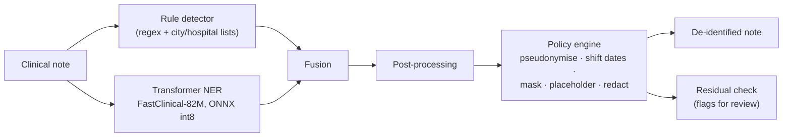

# Clinical Text De-identification (lightweight, CPU-only)

Finds **protected health information (PHI)** in clinical notes and replaces it, so notes can be used for research and
teaching without exposing patients. The system combines **pattern rules** with a **small pre-trained transformer
model**, merges their findings, applies a **configurable replacement policy** per PHI type, and re-checks the output
for anything left behind.

- Runs fully locally on a CPU; no cloud service.
- About 2.7 s per note; the model is 78 MB (ONNX int8).
- No model training: pre-trained models are used as published.
- Supports US-style and **Indian** clinical formats: Aadhaar, PAN, ABHA, UHID/IP numbers, +91 phones, PIN codes,
  S/O–W/O relatives, day-first dates.

The full project report, with architecture, methods, all results and limitations, is in **[REPORT.md](REPORT.md)**.

---

## Results (held-out test sets, never used for tuning)

| Test set | PHI fully removed | Missed entirely | Strict recall | Strict precision |
|---|---|---|---|---|
| US clinical notes (MIMIC-style, 149 notes) | **96.5%** | 1.2% | **95.5%** | 66.4%* |
| Synthetic Indian-format notes (200 notes) | **98.1%** | 0.2% | 84.1%† | **91.1%** |
| Gretel synthetic healthcare documents (251) | **96.2%** | 2.0% | **91.0%** | 82.9%* |

\* A lower bound: the reference labels miss some real PHI.
† Strict recall needs exact boundaries. Addresses are removed as one block while the labels split street, city and
PIN, so recall is lower although the PHI is gone (see REPORT.md §8.4).

**Rules + model beat either one alone.** On the US test set, rules alone reach 90.9% recall, the model alone 89.0%,
and the two together 95.5%.

---

## How it works



| Stage | Code | Settings |
|---|---|---|
| Pipeline | `src/deid/pipeline.py` | — |
| Preprocessing (offset-preserving) | `src/deid/preprocessing/normalize.py` | `configs/detection.yaml` |
| Rule detector | `src/deid/detectors/regex_detector.py` | `configs/detection.yaml`, `configs/gazetteers/` |
| Model detector | `src/deid/detectors/hf_detector.py` | `configs/models.yaml`, `configs/labels.yaml` |
| Fusion | `src/deid/fusion/span_merger.py` | `configs/detection.yaml` |
| Post-processing | `src/deid/postprocess.py` | `configs/detection.yaml` |
| Replacement | `src/deid/policies/transform.py` | `configs/deid_policy.yaml` |
| Residual check | `src/deid/validation/residual.py` | — |
| Metrics and evaluation | `src/deid/evaluation/` | `configs/benchmark.yaml` |

**PHI categories:** PERSON, DATE, TIME, AGE (90+), ORGANIZATION, LOCATION, PHONE, EMAIL, ID, OTHER_PHI (URLs, IP
addresses, vehicle and device identifiers).

---

## Example

**Input:**
```
Patient: Ramesh Kumar S/O Suresh Kumar      Age/Sex: 92 Y/M
UHID: MH/2024/00123   IP No: 24-56789   ABHA: 12-3456-7890-1234
Mob: +91 98765 43210   DOA: 12-Mar-2024 at 1430 hrs   DOD: 18/03/2024 10.30 am
Findings s/o pneumonia; CT chest w/o contrast. Paracetamol 650 mg TID.
```

**Output:**
```
Patient: PERSON_3d1e279b S/O PERSON_bac77356      Age/Sex: [AGE 90+] Y/M
UHID: ID_5aedf825   IP No: ID_dc6de3b2   ABHA: ID_f8ca8fae
Mob: +** ***** *****   DOA: 13-Apr-2022 at [TIME]   DOD: 19/04/2022 [TIME]
Findings s/o pneumonia; CT chest w/o contrast. Paracetamol 650 mg TID.
```

- Names become consistent codes.
- Dates are shifted, but the 6-day stay is kept.
- The phone is masked.
- Clinical text and shorthand (`s/o` = suggestive of, `w/o` = without) are left alone.

---

## Installation (Windows, CPU)

```bat
python -m venv --system-site-packages .venv
.venv\Scripts\python.exe -m pip install -r requirements.txt
.venv\Scripts\python.exe -m pip install -e .
```

- **No CPU build of PyTorch yet?** Install one first:
  `pip install torch --index-url https://download.pytorch.org/whl/cpu`.
- **The deployed ONNX int8 model** needs `onnxruntime` and `onnx`. Create the model file once with
  `scripts\optimize_model.py --model openmed_fastclinical_82m`, or remove the `deployment` entry in
  `configs/models.yaml` to use the PyTorch model.
- **Model weights** are downloaded once from Hugging Face at the pinned revisions in `configs/models.yaml`.
- **On Linux/macOS**, use `.venv/bin/python`.

## Quick start

Run from the project root:

```bat
.venv\Scripts\python.exe -X utf8 scripts\demo_pipeline.py
.venv\Scripts\python.exe -X utf8 -m pytest -q
```

- The demo uses synthetic notes only. It prints the rule findings, the model findings, the merged result and the
  de-identified text under two different policies.
- The tests are 260 unit tests on synthetic text. Three of them need `data/processed/common_lowercase_words.txt`,
  which is built from the licensed notes, and are skipped when that file is absent.

## Main commands

| Task | Command |
|---|---|
| De-identify a CSV of notes | `python scripts/run_deidentification.py --input notes.csv --text-col text --out <folder>` |
| Build the synthetic Indian dataset (with QA) | `python scripts/build_indian_synthetic.py` |
| Download the Gretel data | `python scripts/fetch_gretel_test.py --split test` (or `--split validation`), then `python scripts/build_gretel_eval.py --split test` |
| Evaluate on any labelled JSONL dataset | `python scripts/evaluate_external.py --data <file.jsonl> --name <name>` |
| Compare the five candidate models | `python scripts/benchmark_models.py --stage all` |
| Compress the selected model to ONNX int8 | `python scripts/optimize_model.py --model openmed_fastclinical_82m` |
| Licensed dataset: inspect, derive reference spans, split | `python scripts/inspect_dataset.py`, `python scripts/build_gold.py`, `python scripts/make_splits.py` |

## Changing how PHI is replaced

Edit `configs/deid_policy.yaml`. Each category takes one action:
- `redact`
- `mask` (`keep_first` / `keep_last`)
- `placeholder`
- `pseudonymize`
- `date_shift`
- `retain` (only if the category is listed in `retain_allowed`)

For example, `PHONE: {action: mask, keep_last: 4}` turns `(555) 123-4567` into `(***) ***-4567`.

Set a secret key before producing linkable output:

```bat
set DEID_SECRET_KEY=<64 hex characters>
```

Pseudonyms and date offsets are HMAC-SHA256 values under this key:
- The same person gets the same code.
- All dates of one patient move by the same offset.

Keep the key out of the repository.

---

## Data

| Dataset | In this repository? | Notes |
|---|---|---|
| MIMIC-style discharge notes (249 annotated + 10,000 unlabelled) | **No** (licensed) | Place the archive in the project root and extract it to `data/input/`; paths are in `configs/benchmark.yaml` |
| Synthetic Indian notes (500 notes, 10 document types) | Yes, `data/synthetic_in/` | Fictional. Formats follow the IRDAI, NABH and CAHO discharge-summary layouts (REPORT.md §4) |
| Gretel synthetic PII/PHI documents | Downloaded by script | Apache-2.0 |

## Repository layout

```
configs/            detection, policy, model, label and benchmark settings; gazetteers
src/deid/           data, preprocessing, detectors, fusion, post-processing, policies, validation, evaluation
scripts/            dataset building, benchmarking, evaluation, optimisation, demo, batch de-identification
tests/              unit tests (synthetic text only)
data/synthetic_in/  synthetic Indian dataset, QA report and review samples
REPORT.md           project report: architecture, methods, results, limitations
```

## Limitations

- The MIMIC reference labels were built automatically, so scores are close estimates and precision is a lower bound.
- The Indian results come from synthetic notes. Real annotated Indian notes are needed to confirm them.
- Some PHI is still missed: small towns with no surrounding cue, brand-only lab names, and some foreign postcode and ID
  formats.
- The residual check shares the detectors' blind spots, so human review of flagged notes is still advised.
- Date shifting and pseudonymisation are not literal HIPAA Safe Harbor. Use `placeholder` where strict removal is
  required.

## Privacy

- Licensed clinical text, anything derived from it, model weights and caches are excluded by `.gitignore`.
- Reports contain counts and categories only, never note text.
