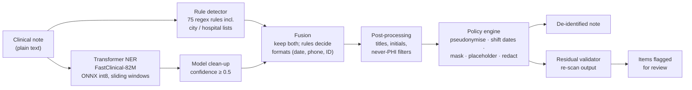
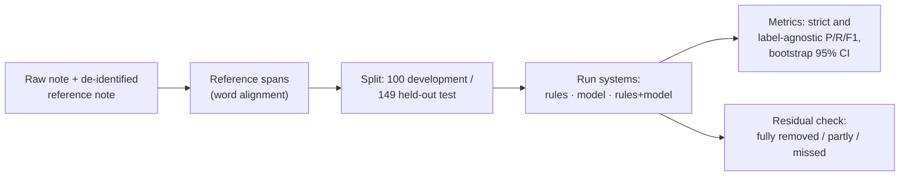

# Clinical Text De-identification — Project Report

---

## 1. Summary

Clinical notes are valuable for research and teaching, but they contain protected health information (PHI): names,
dates, phone numbers, ID numbers, hospitals and addresses. This project builds a de-identification system that:
- finds PHI in free-text notes;
- replaces it in a configurable way;
- runs fully locally on a CPU.

The system combines **pattern rules** with a **small pre-trained transformer model** (OpenMed FastClinical-82M, used
without fine-tuning and compressed to 78 MB).

| Test set (never used for tuning) | PHI fully removed | Missed entirely | Strict recall | Strict precision |
|---|---|---|---|---|
| US clinical notes (MIMIC-style, 149 notes) | **96.5%** | 1.2% | **95.5%** | 66.4%* |
| Synthetic Indian-format notes (200 notes) | **98.1%** | 0.2% | 84.1%† | **91.1%** |
| Gretel synthetic healthcare documents (251) | **96.2%** | 2.0% | **91.0%** | 82.9%* |

\* A lower bound: the reference labels miss some real PHI.
† Strict recall needs exact boundaries. Addresses are removed as one block while the labels split street, city and
PIN (section 8.4).

Processing takes about **2.7 seconds per note** on a CPU, with no cloud service.

---

## 2. Problem and goals

| Goal | How it is met |
|---|---|
| Find nearly all PHI (high recall) | Rules + model are combined; recall is the main selection criterion |
| Avoid over-redaction (good precision) | Context checks in rules, confidence filter, filters for things that are never PHI |
| Run locally | CPU-only inference, ONNX int8 model (78 MB) |
| No training required | Pre-trained models are used as published |
| Configurable output | Per-category actions in a YAML policy file |
| Fair, reproducible measurement | Same data, rules and metrics for every model; held-out test sets; fixed seeds |

**PHI categories (10):** PERSON, DATE, TIME, AGE (≥ 90), ORGANIZATION, LOCATION, PHONE, EMAIL, ID, OTHER_PHI
(URLs, IP addresses, vehicle and device identifiers). They follow the HIPAA Safe Harbor identifiers, extended with
Indian formats: Aadhaar, PAN, ABHA, UHID/IP numbers, +91 phones, PIN codes.

---

## 3. System architecture

### 3.1 Processing pipeline



### 3.2 Components

| Stage | Module | Configuration | What it does |
|---|---|---|---|
| Orchestration | `src/deid/pipeline.py` | — | Loads everything once; `detect()` and `process()` for one note |
| Preprocessing | `src/deid/preprocessing/normalize.py` | `normalize_for_detection` | Offset-preserving folding of quotes, dashes and spaces (off in the final system: no gain) |
| Rule detector | `src/deid/detectors/regex_detector.py` | `configs/detection.yaml` → `regex`, `configs/gazetteers/*.txt` | Dates, times, phones, IDs (with Verhoeff/Luhn checksums), names after cues, hospitals, addresses, Indian formats. Each rule has a guard against clinical text |
| Model detector | `src/deid/detectors/hf_detector.py` | `configs/models.yaml`, `configs/labels.yaml` | Token classification with overlapping windows, BIO/BILOU decoding, label mapping to the 10 categories |
| Fusion | `src/deid/fusion/span_merger.py` | `fusion` | Union of both detectors; rules win label and boundaries for structured types; otherwise the higher confidence wins |
| Post-processing | `src/deid/postprocess.py` | `postprocess` | Confidence filter, title stripping, initials, markup trimming, filters for eponyms, degrees, durations, ward names and state names |
| Replacement | `src/deid/policies/transform.py` | `configs/deid_policy.yaml` | Keyed pseudonyms (HMAC-SHA256), per-patient date shift that keeps intervals and formats, masking, placeholders, redaction, name-variant linking |
| Validation | `src/deid/validation/residual.py` | — | Re-scans the output for leftover PHI; measures leftovers against reference labels |
| Evaluation | `src/deid/evaluation/` | `configs/benchmark.yaml` | Strict and label-agnostic span metrics, bootstrap CIs, error analysis |

### 3.3 Evaluation architecture



---

## 4. Data

| Dataset | Content | Use |
|---|---|---|
| MIMIC-style discharge notes (licensed, **not included in this repository**) | 249 annotated notes (6,130 PHI spans) + 10,000 unlabelled notes | 100 notes for development, 149 held out for the final test |
| Synthetic Indian notes (`data/synthetic_in/`, built here) | 500 notes in 10 document types (discharge summaries, government discharge tickets, OPD, lab, radiology, insurance/TPA, nursing, referral, obstetric, death); 11,034 PHI spans | dev 100 + dev2 200 for development, test 200 held out |
| Gretel synthetic PII/PHI documents (Apache-2.0, fetched by script) | Healthcare documents: 239 validation, 251 test | Validation for development, test held out |

**MIMIC reference labels:** each raw note comes with a de-identified version. Reference spans were derived by aligning
the two word by word (`src/deid/data/gold.py`).

**Indian dataset:** generated by `scripts/build_indian_synthetic.py`.
- Layouts follow the IRDAI standardised discharge summary and the NABH and CAHO discharge-summary formats.
- Names come from 11 regional naming pools, with Indian IDs and addresses.
- Each PHI span is recorded at the moment it is inserted, so offsets are exact.
- Annotation guidelines were fixed before evaluation, following HIPAA Safe Harbor and i2b2 practice:
  - names without titles or degrees;
  - ages only when 90 or above;
  - states and countries not annotated;
  - a generic facility followed by a place (`District Hospital, Barabanki`) → only the place is annotated.
- Automated checks (unlabelled-PHI scan, independent pattern scan, checksum validity, age rules) report 0 issues, and
  samples were reviewed by hand.

All people, numbers and places in the synthetic data are fictional.

---

## 5. Model comparison and selection

Five pre-trained models were run through the same pipeline on the 100 development notes. None was fine-tuned.

| Model | Size | Recall alone | Recall + rules | Precision + rules | Seconds / note |
|---|---|---|---|---|---|
| **OpenMed FastClinical-82M** | 316 MB | **90.6%** | **97.2%** | 67.3% | 4.3 |
| OpenMed LiteClinical-66M | 254 MB | 85.4% | 96.6% | 71.6% | 3.9 |
| OpenMed ClinicalE5-33M | 128 MB | 64.8% | 96.4% | 72.3% | 2.3 |
| OBI deid BERT (i2b2) | 412 MB | 75.8% | 97.1% | 67.9% | 12.2 |
| Stanford de-identifier | 418 MB | 75.4% | 94.5% | 69.0% | 6.6 |
| Rules only | — | — | 92.3% | 78.6% | — |

**Selection rule (fixed in advance):** a model must process a note in under 10 seconds; among those, pick the highest
recall. **FastClinical + rules** was selected; ClinicalE5 + rules is the backup.

**Compression:** ONNX export with dynamic int8 quantisation. Time per note fell from 4.6 to 2.8 s and size from 316 to
78 MB, while recall moved only from 97.1% to 97.0%. That was within the tolerance set in advance.

---

## 6. Replacement policies

| Action | Example | Default for |
|---|---|---|
| Pseudonymise (keyed hash) | `Jane Q. Roe` → `PERSON_1f3e2026` | Names, IDs |
| Shift date (per patient) | `2101-03-04` → `2099-06-22` (a 6-day stay stays 6 days) | Dates |
| Mask | `(555) 123-4567` → `(***) ***-****` | Phones |
| Placeholder | `Lakeside General Hospital` → `[ORGANIZATION]` | Hospitals, places, times |
| Redact | `jane.roe@example.org` → `[REDACTED]`; age 93 → `[AGE 90+]` | E-mails, ages 90+, other |
| Retain | unchanged (only if explicitly allowed) | Off by default |

**Name-variant linking:** `Jane Q. Roe`, `Ms. Roe` and `Jane` get one pseudonym. People who share only a surname are not
merged.

**Day-first dates:** in a note that contains a day-first date such as `18/03/2024`, every numeric date is read
day-first, so intervals stay correct after shifting.

---

## 7. Development history (all decisions on development data)

| Round | Main changes | Effect on development data |
|---|---|---|
| 1 | Title stripping; two-word hospital names with an ordinary-word filter; drop model guesses below 50% confidence; Indian formats; name-variant linking; day-first dates | Mean precision of the five systems 65.8% → 69.8%, recall unchanged |
| 2 | Any `<label> No.: value` identifier and combined fields; house-number addresses; PIN after a city; relatives after `s/o`/`W/O`; employers; filters for eponyms, degrees, durations, `GCS 15/15` | Indian dev: PHI fully removed 91.2% → 98.0%; MIMIC validation: no loss |
| 3 | Unlabelled record numbers with a strong ID shape; `Dr. Kumari` as a surname; relatives after "son"/"wife"; more address forms; filters for drug names after `Inj.`, `Blood Urea`, ward names, `45Y/F` | Gretel validation: recall 86.6% → 94.6%; Indian dev2: missed 0.6% → 0.2%; MIMIC validation: no loss |

Every change was kept only if no development set got worse. The held-out test sets were scored after the changes were
final.

---

## 8. Results

### 8.1 Metrics used
- **Strict precision / recall / F1:** a detection counts only if its start, end and category match the reference
  exactly.
- **Label-agnostic:** exact span, any category.
- **PHI fully removed:** the share of reference PHI items whose characters were all replaced in the output (the
  privacy view).
- **Missed entirely:** reference items with no character replaced.
- **95% confidence intervals:** document-level bootstrap with 1,000 resamples.

### 8.2 US clinical notes — held-out test (149 notes, 3,435 PHI spans)

| System | Strict P | Strict R | F1 |
|---|---|---|---|
| Rules only | 76.0% | 90.9% | 82.8% |
| Model only | 68.3% | 89.0% | 77.3% |
| **Rules + model** | **66.4%** | **95.5%** | **78.3%** |

- 96.5% of PHI items fully removed; 1.4% left an identifying piece or were missed.
- Recall by category: TIME 99.8%, ID 98.4%, DATE 97.2%, PHONE 97.1%, PERSON 90.9%, ORGANIZATION 80.2%, LOCATION and
  EMAIL 100% (few items).
- Precision is understated: inspection showed that many "false alarms" are real PHI the automatically built
  reference does not label.

### 8.3 Synthetic Indian notes — held-out test (200 notes, 4,542 PHI spans)

| | Start | Final |
|---|---|---|
| Strict precision | 84.5% | **91.1%** |
| Strict recall [95% CI] | 78.3% | **84.1%** [83.2–85.0] |
| PHI fully removed | 91.5% | **98.1%** |
| Missed entirely | 4.3% | **0.2%** |

Fully removed by category: DATE, TIME, PHONE, EMAIL, ID, AGE 90+ and OTHER_PHI 100%; PERSON 99.8%; ORGANIZATION
97.4%; LOCATION 91.1%.

### 8.4 Why strict recall (84%) is lower than "fully removed" (98%)

| What happened to each of the 4,542 PHI items | Count | Share |
|---|---|---|
| Removed, exact match with the reference (= strict recall) | 3,820 | 84.1% |
| Removed, different boundaries (586 are addresses) | 637 | 14.0% |
| **Fully removed in total** | **4,457** | **98.1%** |
| Partly removed (75 left only a label word such as "H.No.") | 76 | 1.7% |
| Missed entirely | 9 | 0.2% |

**Example:** `Address : H.No. 2-10-388/B, Bazaar Street, Vijay Nagar, Indore, 452453, Madhya Pradesh`
- The reference marks 3 items: the street part, `Indore` and `452453`.
- The system removes the whole address as one block, so the output is `Address : [LOCATION]`.
- Strict recall counts 0 of 3, because no boundary matches exactly. All 3 items are nevertheless gone from the output.

### 8.5 Gretel healthcare documents — held-out test (251 documents, 874 PHI spans)

| | Start | Final |
|---|---|---|
| Strict precision | 79.0%* | **82.9%*** |
| Strict recall [95% CI] | 83.9% | **91.0%** [88.3–93.4] |
| PHI fully removed | 91.8% | **96.2%** |
| Missed entirely | 6.3% | **2.0%** |

\* In a manual audit of 40 random false alarms, 33 were real PHI that the dataset does not list.

---

## 9. Limitations

- **Automatic labels:** the MIMIC reference labels were derived automatically, so scores are close estimates and
  precision is a lower bound.
- **Synthetic Indian data:** the Indian results come from notes generated for this project. The same generator was
  used for development, so the results may be optimistic. Real annotated Indian notes are needed to confirm them.
- **Still missed:** small towns with no surrounding cue, brand-only lab names (`Thyrocare`), and some foreign formats
  (UK/Canadian postcodes, UK National Insurance numbers).
- **Review still needed:** the residual validator uses similar patterns to the detectors and shares their blind
  spots, so human review of flagged notes is still advised.
- **Safe Harbor:** date shifting and pseudonymisation are not literal Safe Harbor. Use the `placeholder` action where
  strict removal is required.
- **No fine-tuning:** the models were used as published.

## 10. Future work

- Annotate a sample of real Indian discharge summaries.
- Fine-tune the selected model on in-domain notes (with approval and a proper training set).
- Add a large public place-name list (for example the India Post office directory), measured on real data.
- Build a review screen for flagged items.
- Keep pseudonyms consistent across all of a patient's notes with secure key storage.

---

## 11. How to run

```bat
python -m venv .venv
.venv\Scripts\python.exe -m pip install -r requirements.txt
.venv\Scripts\python.exe -m pip install -e .
.venv\Scripts\python.exe -X utf8 scripts\demo_pipeline.py
.venv\Scripts\python.exe -X utf8 -m pytest -q
```

- **Demo** (synthetic notes): `scripts\demo_pipeline.py`
- **Tests:** 260 tests. Three of them need `data/processed/common_lowercase_words.txt`, which is built from the
  licensed notes by `scripts/build_common_words.py`; they are skipped when it is absent.
- **Indian dataset:** `scripts\build_indian_synthetic.py`
- **Gretel data:** `scripts\fetch_gretel_test.py --split test|validation`, then `scripts\build_gretel_eval.py`
- **Evaluation on a labelled dataset:** `scripts\evaluate_external.py --data <file.jsonl> --name <name>`
- **The compressed model** is created by `scripts\optimize_model.py`. Model weights are downloaded from Hugging Face
  at the pinned revisions in `configs/models.yaml`.

## 12. Repository structure

```
configs/     detection, policy, model, label and benchmark settings; gazetteers
src/deid/    data loading, preprocessing, detectors, fusion, post-processing, policies, validation, evaluation, pipeline
scripts/     dataset building, benchmarking, evaluation, optimisation, demo
tests/       unit tests (synthetic examples only)
data/synthetic_in/   synthetic Indian dataset with QA report and review samples
```

## 13. Privacy notes

- The licensed clinical notes, anything derived from them, model weights and caches are excluded from version
  control (`.gitignore`).
- Reports contain counts and categories only, never note text.
- The pseudonymisation key is read from the `DEID_SECRET_KEY` environment variable and must never be committed.
